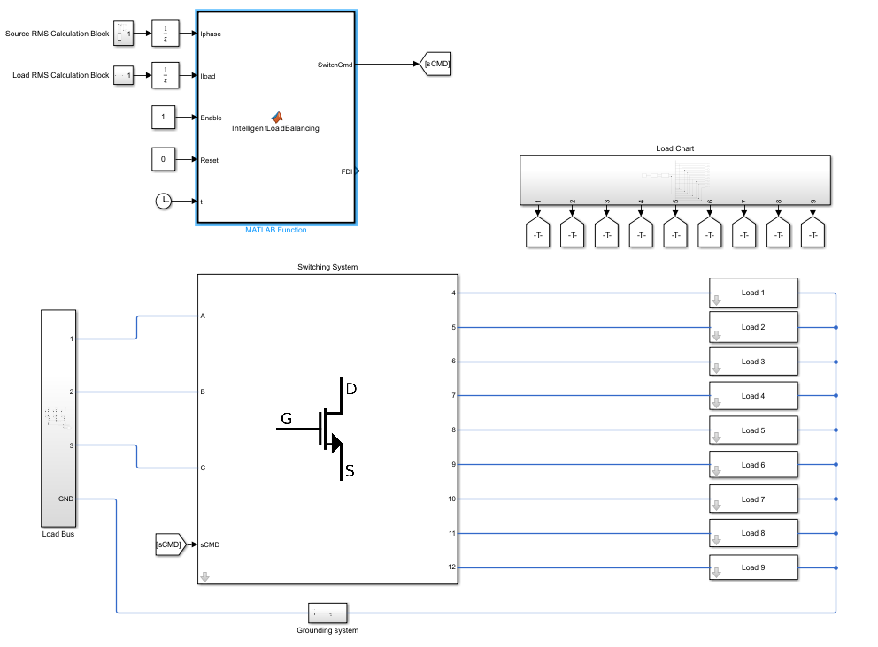

# İHA Elektrik Güç Sistemleri için Aktif Yük Dengeleme

Üç fazlı bir İHA elektrik güç sisteminde faz akımlarını izleyen ve yükleri fazlar arasında yeniden atayarak dengesizliği azaltmayı amaçlayan MATLAB/Simulink projesi.

## Proje özeti

- 115 V RMS faz-nötr gerilimi ve 400 Hz besleme frekansı
- Seri R-L yük modeliyle temsil edilen 9 elektriksel yük
- Yükleri A, B veya C fazına bağlayan 27 anahtarlama komutu
- Dört uçuş aşamasına göre değişen yük koşulları: taksi (G5), kalkış ve tırmanış (G6), seyir (G7), alçalma ve iniş (G9)
- Faz RMS akımlarına göre FDI hesaplama, eşik/histerezis kontrolü ve fazlar arasında yük aktarımı

## Sistem mimarisi

Model; üç fazlı besleme, anahtarlama sistemi, dokuz yük, RMS ölçümleri ve MATLAB Function bloğundaki dengeleme algoritmasından oluşur.



## Algoritma

Faz dengesizlik indeksi (FDI), faz akımlarının ortalamasına göre hesaplanır:

```text
Iort = (IA + IB + IC) / 3
FDI = max(|IA - Iort|, |IB - Iort|, |IC - Iort|) / Iort × 100
```

FDI %5'i aştığında dengeleme başlar; %3'e veya altına düştüğünde durur. Dengeleme aktifken en yüksek akımlı fazdan en düşük akımlı faza, kaynak fazdaki RMS akımı en düşük yük aktarılır. Art arda aktarımlar arasında en az 100 ms beklenir ve dengeleme ilk 0,35 saniye etkinleşmez.

Algoritma kaynağı: `src/IntelligentLoadBalancing.m`. Fonksiyon, üç fazın RMS akımlarını, dokuz yükün RMS akımlarını, etkinleştirme/reset girişlerini ve simülasyon zamanını alır; 27 elemanlı anahtarlama komutları ile FDI çıktısını üretir.

## Başlatma

1. MATLAB/Simulink ve modelin kullandığı Simscape Electrical/Stateflow bileşenlerini içeren bir MATLAB kurulumu açın.
2. Depo klasörünü MATLAB çalışma klasörü olarak seçin.
3. `models/UAV_Load_Balancing_Main.slx` modelini açıp simülasyonu çalıştırın.

MATLAB sürümüne ve kurulu ürünlere bağlı olarak model uyarlaması gerekebilir. Simülasyon sonuçları kullanılan çözücüye, anahtarlama elemanlarına ve yük parametrelerine bağlıdır.

## Depo içeriği

| Yol | İçerik |
|---|---|
| `models/` | Simulink modeli |
| `src/` | Aktif yük dengeleme MATLAB Function kodu |
| `data/` | Geliştirme notları, yük verileri ve simülasyon görselleri |
| `paper/` | Proje raporunun PDF ve DOCX sürümleri |

## Durum

Bu depo akademik/portföy amaçlı bir simülasyon çalışmasını içerir. Sonuçlar belirli donanım üzerinde doğrulanmış uçuşa elverişlilik veya sertifikasyon iddiası değildir.
